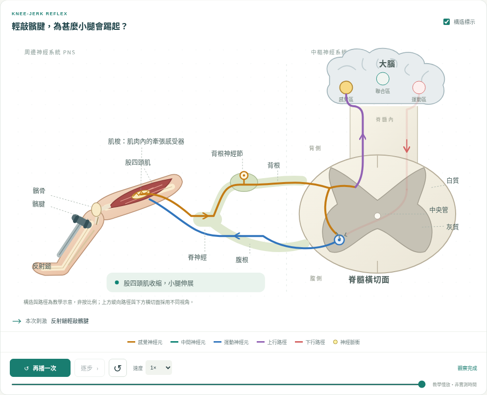
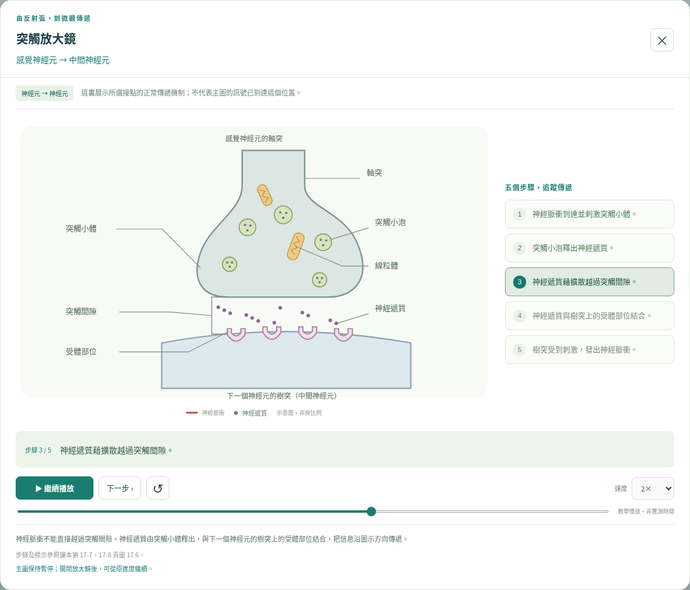

# 反射弧實驗室 · Reflex Arc Lab

為香港中五生物課堂而設的繁體中文互動模擬。整合退縮反射、膝躍反射與隨意動作，讓學生按「設定條件 → 預測 → 觀察 → 解釋」探究神經協調。



## 開啟使用

下載本儲存庫後，直接用現代瀏覽器開啟 **`index.html`**；保留同一資料夾中的 `styles.css`、`model.js`、`synapse.js`、`app.js`。不需要登入、API 金鑰或網絡連線。支援 Chrome、Edge、Firefox、Safari 的現行版本。

如需一個可隨身攜帶的 HTML 檔案，使用 Node.js 20 或以上：

```sh
npm run build
```

開啟產生的 **`dist/reflex-arc.html`**。這是包含全部圖像、樣式及程式的離線單檔，不需要安裝 npm 套件才能產生。亦可從本儲存庫的 **`reflex-arc.html`** 直接下載已產生的單檔。

## 課堂功能

- **三個情境**：退縮反射、膝躍反射、隨意動作。切換情境時保留受損條件，方便作對照。
- **五種可複選受損路徑**：感覺神經元、退縮反射弧內中間神經元、運動神經元、上行感覺路徑、下行運動路徑。不適用的開關會停用。
- **先預測再觀察**：可選預測；開始後鎖定答案，完成後核對。
- **播放工具**：暫停、逐步、重設、調速及拖動進度。時間只代表教學動畫，不是生理反應時間。
- **兩層解說**：精簡流程＋詳細事件紀錄；反射與上行訊息並行傳遞，一條支路失敗不會錯誤終止另一條。
- **突觸放大鏡**：點選主圖中的編號，或圖下方的接點按鈕，觀察微觀傳遞。神經元版依課本圖 17.6 分五步；肌肉版分六步，先顯示電脈衝形成及傳遞，再顯示收縮。支援播放、暫停、逐步及重播；標示採課本用語，引線指向實際構造，神經遞質的引線隨動畫移動。
- **比較紀錄**：在本頁保留已完成實驗，可匯出有 UTF-8 BOM 的 CSV，方便以 Excel 開啟。重新整理網頁會清空紀錄。
- **投影模式**：收起設定面板、放大主圖；Esc 返回。另有構造標示開關及列印版面。
- **完全本機運作**：沒有遙測、廣告、外部字型或執行時網絡依賴。

## 建議示範次序（約 12–15 分鐘，可按課堂調整）

1. **正常退縮反射**：預測先縮手還是先痛，逐步追蹤並行支路。
2. **上行受損**：有反射、沒有本次感覺，說明局部反射不必等待大腦。
3. **反射弧內中間神經元受損**：沒有反射、仍感到痛。按「另測主動屈臂能力」，保留條件測試大腦主動發令。
4. **運動神經元受損**：仍有感覺，但反射及另行測試的主動動作都不能完成。
5. **膝躍反射**：辨認髕腱、股四頭肌內肌梭及兩神經元的伸肌主反射弧。
6. **隨意動作**：感覺神經元受損後，比較「先感到輕觸才決定屈臂」與「大腦主動發令」。

指南按鈕內亦有完整教學次序及科學範圍。尖銳刺激只在畫面模擬，不需要在學生身上實作。

講解突觸時，可在退縮反射點選「感覺 → 中間」，然後比較「運動 → 肌肉」。放大鏡開啟時主圖暫停，關閉後保留原進度。若所選神經路徑已受損，視窗會說明本次訊號不能到達該接點；放大圖仍可獨立展示**正常傳遞機制**，不會因此改變主圖實驗結果。

神經元之間的五步依第 17-7、17-8 頁圖 17.6 編排：神經脈衝到達突觸小體 → 突觸小泡釋出神經遞質 → 神經遞質藉擴散越過突觸間隙 → 與樹突上的受體部位結合 → 樹突發出神經脈衝。肌肉版按同一原理延伸：接收一方改為肌纖維，第五步先產生電脈衝，第六步才顯示電脈衝沿肌纖維傳遞，引致肌肉收縮；不把這個延伸冒稱為課本圖 17.6 的原圖。



## 科學準確性的範圍

這是高中程度的**功能路徑模型**，不是逐一神經束的解剖圖或臨床損傷診斷工具。主要依據使用者提供的 `te_17_c.pdf` 第 17 章，圖 17.14、17.16–17.18。原稿分析、修正理由及模型邊界見 [docs/design-and-science.md](docs/design-and-science.md)。

尤其注意：膝反射的肌梭在肌肉內，髕腱是敲擊處；伸肌的單突觸主反射弧不含中間神經元，但拮抗肌的交互抑制會涉及中間神經元。感覺功能、對特定刺激的動作及主動運動能力分開處理；「未測」不等於「沒有」。

## 開發與驗證

不需建置亦可開發。若想透過本機伺服器開啟：

```sh
npm start
```

伺服器預設使用連接埠 `4173`，可用 `PORT` 環境變數更改。Node.js 內建測試不需額外套件：

```sh
npm test
npm run build
```

完整瀏覽器檢查：

```sh
npm ci
npx playwright install chromium
npm run test:browser
```

如已有 `/usr/bin/chromium`，測試會直接使用；也可用 `CHROMIUM_PATH` 指定瀏覽器。瀏覽器測試會自行啟動連接埠 `4174` 的臨時伺服器，完成後關閉。截圖及 CSV 存於忽略追蹤的 `test-results/`。

測試包括獨立結果表、128 組模式及多重受損動畫一致性檢查、並行支路、播放／暫停／重設、預測評分、實驗紀錄、CSV、行動版及離線單檔。雲端的受管理瀏覽器禁止 `file://` 導航，因此離線測試把實際單檔內容載入無網絡的空白文件；未在該瀏覽器直接雙擊檔案驗證。

如修改來源，重新產生根目錄的便攜版本：

```sh
npm run build
node -e "require('node:fs').copyFileSync('dist/reflex-arc.html','reflex-arc.html')"
```

## 檔案

| 檔案 | 用途 |
| --- | --- |
| `index.html` | 可存取的介面及原創 SVG 解剖示意 |
| `styles.css` | 桌面、投影、平板、手機與列印版面 |
| `model.js` | 無 DOM 的功能模型、結果、並行事件時間線及因果解釋 |
| `app.js` | 單一動畫時鐘、互動、預測、紀錄與匯出 |
| `synapse.js` | 五步神經元／六步肌肉放大鏡、接點切換及獨立微觀動畫時鐘 |
| `reflex-arc.html` | 已產生、可離線雙擊開啟的便攜單檔 |
| `tests/` | 模型及瀏覽器功能測試 |
| `scripts/` | 零執行時依賴的伺服器及單檔產生工具 |

原始附件及教材 PDF 未放入儲存庫；圖像均為本專案重新繪製。
